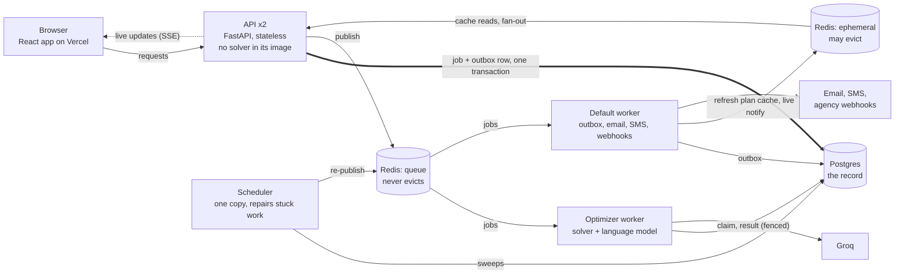

# Merydian

Merydian plans group trips for several families at once and keeps the plan current as people change their minds.
A travel agent adds customers and trips. A constraint solver builds a day-by-day plan that respects each family's
pace, budget and interests. Travellers read the plan and send feedback in plain words; a language model turns the
feedback into constraints, the solver re-plans, and the agent approves what needs a decision.

| | |
|---|---|
| **Web app** | https://merydian-eta.vercel.app |
| **API reference** | https://meridian-api-hvlw.onrender.com/docs |
| **Is it healthy?** | https://meridian-api-hvlw.onrender.com/health/ready |
| **Operations page** | https://meridian-api-hvlw.onrender.com/ops (queues, workers, jobs, outbox, grouped errors) |

It is an academic project. There is no live supplier booking: hotel and flight bookings are recorded, not made.
On Render's free tier the API sleeps when idle, so the **first request after a quiet spell can take up to a minute**.

---

## Contents

1. [Try it in two minutes](#1-try-it-in-two-minutes)
2. [Test it by hand](#2-test-it-by-hand)
3. [System design](#3-system-design)
4. [Tech stack, and why each piece](#4-tech-stack-and-why-each-piece)
5. [Run it locally](#5-run-it-locally)
6. [Checks and failure drills](#6-checks-and-failure-drills)
7. [Repository layout](#7-repository-layout)
8. [Documentation](#8-documentation)
9. [Known limits](#9-known-limits)

---

## 1. Try it in two minutes

1. Open https://merydian-eta.vercel.app and choose **Explore the demo** (or go to `/demo`).
2. Pick a persona. Nothing to sign up for; each visit starts with fresh data.
   - **Travel Agent**: sees every seeded trip, the Desk of pending decisions, insights and the AI agents.
   - **Family Vacation, Luxury Couple, Budget Backpacker, Elderly Travellers, Accessibility Trip**: travellers,
     each with a trip already planned and a story of how feedback changed it.
3. As a traveller, open your trip, then **Changes** to see what the AI changed and why.
   As the agent, open **Desk** to see the decisions waiting for you.

---

## 2. Test it by hand

Everything below is done in the browser. No commands.

### 2.1 What each role can see

| Role | Menu | What it is for |
|---|---|---|
| **Travel agent** | Overview, Desk, Agents, Calendar, Insights, Trips, Customers, Bookings, plus Settings and Webhooks | Run customers and trips, approve changes, see the business |
| **Traveller** | My trips, Plan a trip, plus Settings | Read the plan, ask for changes, see what changed |

Every trip has the same tabs: **Plan** (timetable and map), **Changes** (what changed and why), **History**
(every version), **Group** (families sharing the trip, shared expenses, checklist), **Bookings**, **Notes**
(agent only) and **Feedback**.

### 2.2 The full story with real accounts (about 10 minutes)

Use two browser windows side by side, or one normal and one private window: the **agent** on the left, the
**customer** on the right. [docs/DEMO_WALKTHROUGH.md](docs/DEMO_WALKTHROUGH.md) has the same story with a talk
track for presenting it, and `demo-run/record_walkthrough.py` plays it through on its own against a local server,
saving a screenshot of every step.

| # | Window | Do this | You should see |
|---|---|---|---|
| 1 | Agent | Go to **Sign up**, choose **Travel agent**, enter the agent code and a new agency name (for example "Lotus Journeys") | You land on Overview. The agency is yours alone. The agent code is set by whoever runs the server; ask the project owner, or use the demo's Travel Agent persona instead |
| 2 | Agent | **Customers**, add a customer: a name, an email you can read, 3 travellers, 1 child | The customer appears, with an invitation link under it. With email set up on the server they also get it by email; otherwise copy the link |
| 3 | Agent | Open the customer, set a relaxed pace and high interest in nature, save | Saved preferences. They drive the solver for every trip planned for this family |
| 4 | Agent | **Trips**, plan a trip for that customer, build the first plan, then **Approve and publish** | A three-day plan appears in a few seconds. The customer sees nothing until you approve it |
| 5 | Customer | Open the invitation link, choose a password | You land on the customer's trip: a timetable, photos and a map |
| 6 | Customer | **Feedback**, then **Ask for a specific place**, pick one (for example Sarojini Nagar Market) | A confirmation. The plan does not change yet; the request goes to the agent |
| 7 | Agent | Watch the agent window, no refresh | A toast and the bell light up within a second or two. That is the live stream |
| 8 | Agent | **Desk**, open the request, compare the two options, **Accept** | The cost difference and how well it fits are shown before you choose. Declining keeps the plan as it was |
| 9 | Customer | Open the bell | "Your plan changed". The trip is now version 2 (see **History**) |
| 10 | Customer | **Feedback** again, this time in your own words: "we have a small child, keep the days shorter and add something outdoors" | The page says the plan is being updated. It takes about 10 to 40 seconds, because a language model reads the message |
| 11 | Customer | **Changes** | Stops struck through or added, each with a reason in plain words, and the effect on cost and fit |
| 12 | Agent | Open the trip, **Bookings**: record a hotel and confirm. **Notes**: add a task | The customer sees the booking. Notes and tasks are private to the agency |
| 13 | Agent | **Insights**, then **Agents** | Business numbers (value, acceptance rate, time to decide) and the AI agents with their reliability |

### 2.3 Things worth checking on purpose

These are the parts of the backend you can see working from the browser.

| Check | How | What proves it |
|---|---|---|
| **Agencies are private** | Sign up a second agent with a different agency name, then look at Customers and Trips | The first agency's customers and trips are not there |
| **Live updates** | Keep the agent's Desk open while the customer asks for a place | The request appears without a refresh |
| **Nothing is lost if the plan is slow** | Send free-text feedback, then close the tab and come back a minute later | The new version is there. The work ran in the background and was never tied to your browser |
| **Wrong passwords are limited** | On Sign in, enter a wrong password for one account five times | The next attempt is refused for 15 minutes, even with the right password |
| **The cache never shows an old plan** | Right after the agent accepts a change, refresh the customer's trip | The new version, at once |
| **Exports** | On a trip's **Plan**, use the calendar download and **Print**. On Trips, Customers, Bookings or Insights, export CSV | An `.ics` file your calendar app opens, a printable timetable, and spreadsheets of each list |
| **API keys and webhooks** | Agent **Settings**: create an API key. **Webhooks**: add an endpoint | The key works against the API reference; webhook deliveries are signed and logged |
| **Sign out everywhere** | API reference at `/docs`, `POST /api/v1/auth/logout-all` with your token | Every session ends, and an access token issued before it is refused at once |
| **Health and operations** | Open `/health/ready` and `/ops` on the API | Readiness says *why* when something is wrong; `/ops` shows queues, workers, jobs, the outbox and grouped errors |

---

## 3. System design

The full design, with every decision and the reason for it, is in
[docs/TARGET_ARCHITECTURE.md](docs/TARGET_ARCHITECTURE.md). The short version: **Postgres is the record, Redis
only delivers, and a worker owns a job only under a fence.**

### 3.1 The services



| Service | What it does | Why it is separate |
|---|---|---|
| **API** (FastAPI) | Answers requests, writes jobs, streams live updates. Holds no state of its own, so any copy can serve any request | It never runs the solver, so a slow plan can never block a request. Its image has no solver and no model client at all |
| **Optimizer worker** | Runs the language model and the OR-Tools solver, one job per core | Plans are heavy and slow; they get their own queue so they never delay anything else |
| **Default worker** | Delivers the outbox: notifications, email, SMS, webhooks, cache refreshes | Light, fast work that should never wait behind a plan |
| **Scheduler** | Every few seconds: re-publishes lost jobs, takes over jobs whose worker died, releases stuck outbox rows, expires old keys | Something has to repair what breaks while nobody is looking. One copy acts at a time |
| **Postgres** | Users, trips, plans and every version, jobs, the outbox, idempotency keys, error groups | The only source of truth. Everything else can be rebuilt from it |
| **Redis: queue** | The job queue, locks, sign-in lockout counters, worker heartbeats. Never evicts, keeps an append-only file | Losing a key here loses work or resets a protection |
| **Redis: ephemeral** | The plan cache, low-value rate limits, live notification fan-out. May evict, keeps nothing on disk | Losing a key here only costs speed |

On Render all of this runs in one container (a showcase on a free tier). `docker compose up --build` runs it
the way it is designed: two API copies, both workers, the scheduler, Postgres and both Redis instances.

### 3.2 What happens when a traveller sends feedback

1. **The API saves the job and an outbox row "publish this job" in one transaction**, and answers at once with
   the job's id. If the process dies a moment later, the job is still saved and will be published.
2. **The outbox publishes it to the queue.** Usually immediately; if that fails, a dispatcher retries, and the
   scheduler re-publishes anything that was lost.
3. **A worker claims the job** with one conditional update that raises the job's **fence number**. Only one
   worker can win. It renews a **lease** every 30 seconds while it works.
4. **It works:** the language model turns the message into constraints, the solver re-plans.
5. **It commits everything in one transaction:** the new plan version, the "current plan" pointer, the
   announcements, and the job marked done. The transaction first checks the fence. A worker that was paused,
   lost its lease and woke up late finds the fence has moved on, and its result is thrown away.
6. **The same transaction raises the family's plan revision** and queues a cache refresh. Redis keeps a cached
   plan only if its revision is newer, so an old plan can never come back.
7. **Announcements go out:** the live stream wakes every open page, email and webhooks follow. Every message
   carries a stable id, so a repeat delivery changes nothing.

### 3.3 The guarantees, and what provides each

| Guarantee | Provided by |
|---|---|
| An accepted job is never lost, even if the API, Redis or a worker fails | The job and its outbox row commit together; a dispatcher, a lease, and the scheduler's re-publish |
| A result is written once | A fence number checked inside the transaction that saves the result |
| Two re-plans of one trip never overwrite each other | The fence, a row lock on the family, and a database rule against duplicate version numbers |
| A repeated request repeats nothing | Idempotency keys stored in Postgres, unique per caller |
| The API never waits on a solve | Plans are background jobs; trip creation answers 202 Accepted after 8 seconds and the page follows the job |
| Losing Redis costs time, not data | Postgres is the record; the queue instance never evicts; the cache follows Postgres |
| The cache never shows an older plan, and is never required | A plan revision raised with every change; newer-only writes; a missing entry rebuilt once; Postgres when Redis is down |
| A database restart does not lose a request | A lost connection hands the job back to the queue; an expired lease is taken over |
| Guessing passwords is bounded | Account lockout and per-address limits, counted on the Redis that never evicts |
| Failures are visible | `/metrics`, `/ops` with errors grouped by type and code location, readiness that names the cause, one request id from the browser to the worker's log |

The honest wording for delivery is *at-least-once delivery from the database, with consumers that tolerate
repeats*. It is not "zero message loss".

### 3.4 Decisions left out on purpose

No Kubernetes, Kafka or separate optimizer service: at this size they would add operations without adding a
guarantee. Webhooks are kept as an optional channel for agencies; the browser is served by the live stream.
[docs/DESIGN_REVIEW_AND_FIXES.md](docs/DESIGN_REVIEW_AND_FIXES.md) records each design question raised, the
verdict and the fix.

---

## 4. Tech stack, and why each piece

| Layer | Technology | Why this one |
|---|---|---|
| Web app | React 19, TypeScript, Vite | Typed components, fast builds, the ecosystem the rest of the stack plugs into |
| Data fetching | TanStack Query | Caching, retries and background refresh of server data without hand-written state |
| Styling | Tailwind CSS v4 | The design system ("The Printed Timetable", see [DESIGN.md](DESIGN.md)) as tokens and utilities |
| Maps and motion | Leaflet, GSAP | Real maps for each day's route; restrained motion |
| API | FastAPI | Async request handling for the live stream, request validation and a generated API reference at `/docs` |
| Data access | SQLModel on SQLAlchemy 2 | One model for validation and the database; explicit transactions where correctness depends on them |
| Schema changes | Alembic | Every change is a reviewed migration; old databases are adopted or refused, never guessed at |
| Database | Postgres 15 (Neon in production) | Transactions, row locks and unique rules carry the system's guarantees; JSONB holds each plan version |
| Background work | Celery | Mature task queue with named queues, so solver work and light work never share a line |
| Queue and cache | Redis 7, two roles | Split by what a lost key costs: queued work on one that never evicts, cache and live fan-out on one that may |
| Solver | Google OR-Tools CP-SAT | Exact constraint solving for timing, opening hours, budget and preferences; a three-day plan in seconds |
| Language model | Groq, `openai/gpt-oss-20b` | Fast inference to turn free-text feedback into constraints and to explain changes in plain words |
| Sign-in | JWT (PyJWT, HS256), bcrypt | Stateless access tokens with refresh tokens, revocable per session or everywhere at once |
| Live updates | Server-sent events over Redis pub/sub | One-way updates to the browser are all that is needed; works through proxies with no extra protocol |
| Hosting | Render (API and workers), Vercel (web app), Neon (Postgres) | Free tiers that still run the real architecture; Docker images make them replaceable |
| CI | GitHub Actions, Dependabot, pip-audit | Every drill runs on every pull request; dependencies are watched for advisories |

---

## 5. Run it locally

You need Docker. For the web app, also Node 20 and pnpm.

```bash
cp .env.example .env           # fill in SECRET_KEY, and GROQ_API_KEY for feedback re-planning
docker compose up --build      # Postgres, both Redis roles, migrations, two API copies, both workers, the scheduler
```

The API is on http://localhost:8000 (reference at `/docs`) and a second copy on :8001. Then the web app:

```bash
cd "frontend V2" && pnpm install && pnpm dev
```

Open http://localhost:5173. Set `SEED_ON_START=true` to load the demo personas, and `AGENT_SIGNUP_CODE` to the
code agents must enter at sign-up. Every setting is listed in [.env.example](.env.example); real values never go in
the repository. Deploying to Neon, Render and Vercel is step by step in [docs/DEPLOY.md](docs/DEPLOY.md).

---

## 6. Checks and failure drills

Every guarantee in section 3.3 has a script under `backend/scripts/deploy/` that proves it against a real
Postgres, Redis, API and worker, by breaking something on purpose: killing a worker mid-job, restarting Postgres,
losing Redis messages, stopping the cache, an API copy dying under a live stream, a paused worker waking after a
takeover, ten identical requests at once.

```bash
cd backend && python scripts/deploy/drills.py --images
```

The latest run is in [docs/DRILL_REPORT.md](docs/DRILL_REPORT.md): **14 drills, 203 checks, 0 failures**. The same
checks run in CI on every pull request ([.github/workflows/ci.yml](.github/workflows/ci.yml)). A deployed server
can be checked with `python backend/scripts/deploy/smoke_test.py https://<api> <agent-code>` (28 checks; it
creates test accounts, so point it at a staging copy).

---

## 7. Repository layout

| Folder | Contents |
|---|---|
| `backend/` | FastAPI app (`app/`), migrations, the scheduler, workers, and the check and drill scripts |
| `frontend V2/` | The React web app |
| `agents/` | Language-model agents: feedback parsing, explanations |
| `ml_or/` | The OR-Tools optimizer and its data |
| `docs/` | Design, plans, deployment, drill report; `docs/archive/` holds older analyses |
| `demo-run/` | A script that plays the walkthrough and screenshots every step (the screenshots stay local) |
| `contracts/` | Early API contracts |
| `frontend/` | The first web app, kept for reference; `frontend V2` replaces it |

---

## 8. Documentation

| File | Contents |
|---|---|
| [docs/TARGET_ARCHITECTURE.md](docs/TARGET_ARCHITECTURE.md) | The system design: services, the life of a job, guarantees, the plan cache |
| [docs/DESIGN_REVIEW_AND_FIXES.md](docs/DESIGN_REVIEW_AND_FIXES.md) | Every design problem raised, the verdict and the fix |
| [docs/ARCHITECTURE_PLAN.md](docs/ARCHITECTURE_PLAN.md) | The milestone plan, the build log and the defects found on the way |
| [docs/PRODUCTION_HARDENING.md](docs/PRODUCTION_HARDENING.md) | What the backend lacked, how it would have failed, and what was built |
| [docs/DRILL_REPORT.md](docs/DRILL_REPORT.md) | The latest run of every check and failure drill |
| [docs/DEPLOY.md](docs/DEPLOY.md) | Deployment runbook and troubleshooting |
| [docs/DEMO_WALKTHROUGH.md](docs/DEMO_WALKTHROUGH.md) | The agent-and-customer story with a talk track |
| [docs/USE_AND_EXTEND.md](docs/USE_AND_EXTEND.md) | How the system can be used and extended |
| [PRODUCT.md](PRODUCT.md), [DESIGN.md](DESIGN.md) | Who it is for, and the visual design system |

---

## 9. Known limits

- **One city, three days.** Plans cover Delhi over three days, which is what the optimizer's data holds.
- **No live supplier.** Bookings are a record kept by the agent.
- **Free-text re-plans can move many stops.** The solver re-plans the whole trip, so "shorter days" can change a
  lot at once. A request for one specific place changes one stop.
- **Free hosting sleeps.** The first request after a quiet spell can take up to a minute, and a free-text re-plan
  takes 10 to 40 seconds because the language model call dominates.
- **Load is not measured.** The drills prove correctness under failure, not throughput or latency under load.
