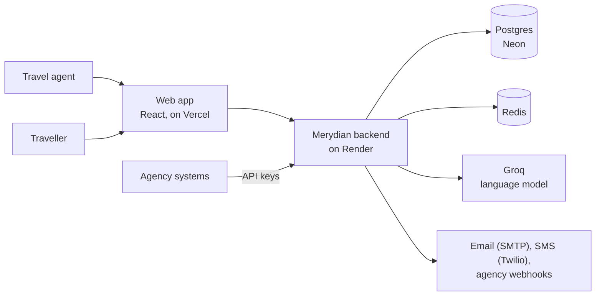
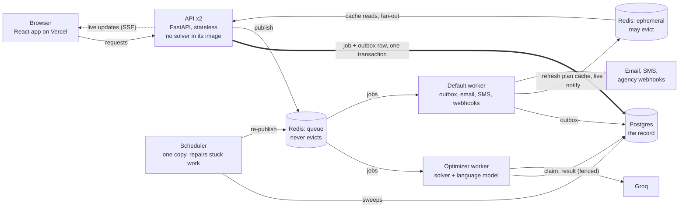
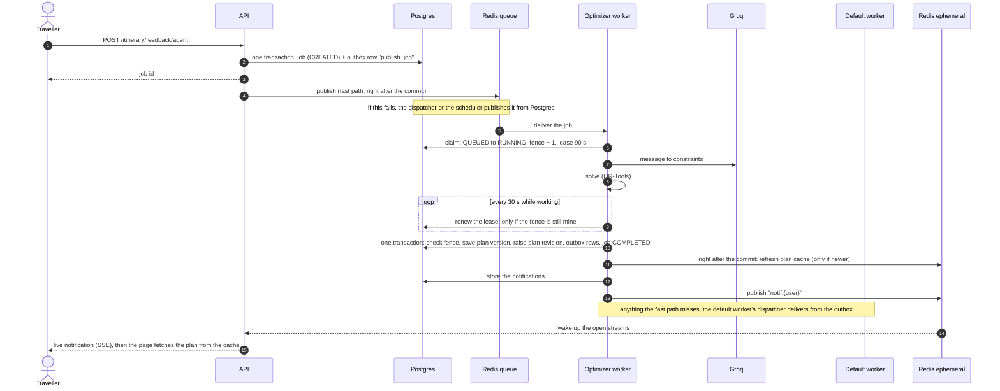
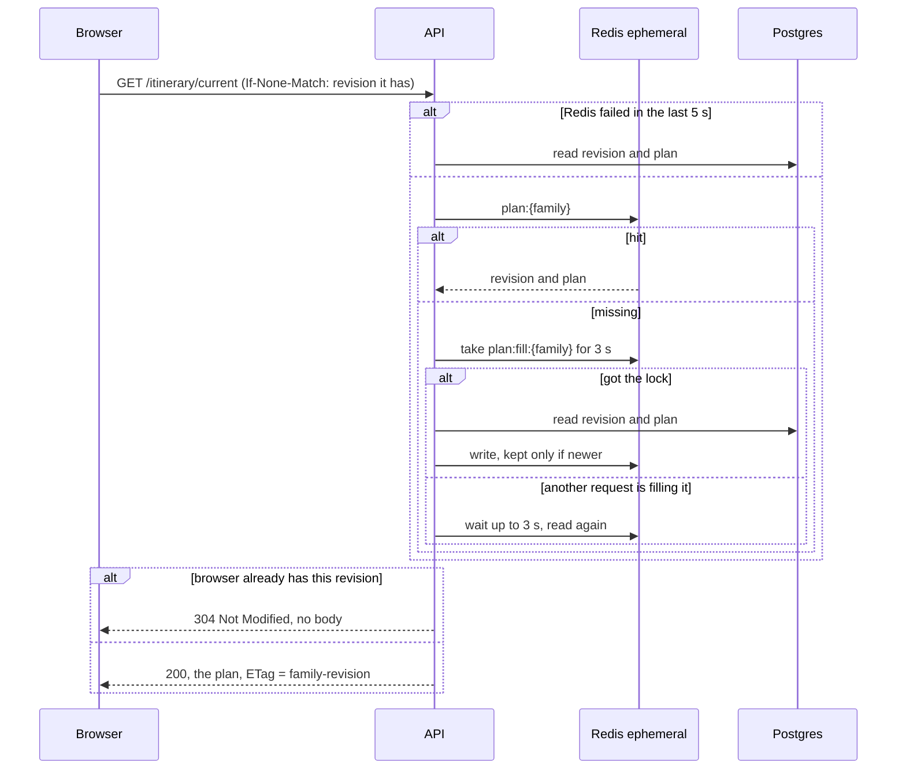
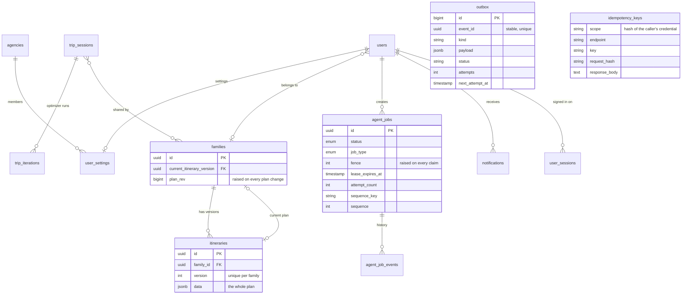
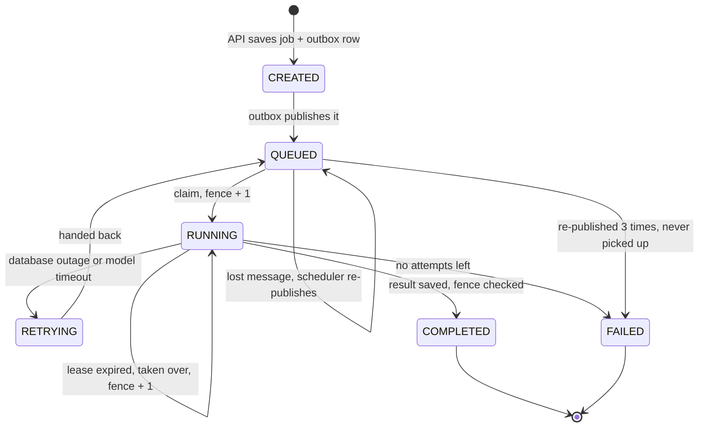

# Merydian

Merydian plans group trips for several families at once and keeps the plan current as people change their minds.
A travel agent adds customers and trips. A constraint solver builds a day-by-day plan that respects each family's
pace, budget and interests. Travellers read the plan and send feedback in plain words; a language model turns the
feedback into constraints, the solver re-plans, and the agent approves what needs a decision.

| | |
|---|---|
| **Web app** | https://merydian-eta.vercel.app |
| **API reference** | https://meridian-api-hvlw.onrender.com/docs |
| **Is it healthy?** | https://meridian-api-hvlw.onrender.com/health/ready |
| **Operations page** | https://meridian-api-hvlw.onrender.com/ops (queues, workers, jobs, outbox, grouped errors) |

It is an academic project. There is no live supplier booking: hotel and flight bookings are recorded, not made.
On Render's free tier the API sleeps when idle, so the **first request after a quiet spell can take up to a minute**.

---

## Contents

1. [Try it in two minutes](#1-try-it-in-two-minutes)
2. [Test it by hand](#2-test-it-by-hand)
3. [System design](#3-system-design): [high level](#part-a-high-level-design), [low level](#part-b-low-level-design), [guarantees](#part-c-guarantees-and-trade-offs)
4. [Tech stack, and why each piece](#4-tech-stack-and-why-each-piece)
5. [Run it locally](#5-run-it-locally)
6. [Checks and failure drills](#6-checks-and-failure-drills)
7. [Repository layout](#7-repository-layout)
8. [Documentation](#8-documentation)
9. [Known limits](#9-known-limits)

---

## 1. Try it in two minutes

1. Open https://merydian-eta.vercel.app and choose **Explore the demo** (or go to `/demo`).
2. Pick a persona. Nothing to sign up for; each visit starts with fresh data.
   - **Travel Agent**: sees every seeded trip, the Desk of pending decisions, insights and the AI agents.
   - **Family Vacation, Luxury Couple, Budget Backpacker, Elderly Travellers, Accessibility Trip**: travellers,
     each with a trip already planned and a story of how feedback changed it.
3. As a traveller, open your trip, then **Changes** to see what the AI changed and why.
   As the agent, open **Desk** to see the decisions waiting for you.

---

## 2. Test it by hand

Everything below is done in the browser. No commands.

### 2.1 What each role can see

| Role | Menu | What it is for |
|---|---|---|
| **Travel agent** | Overview, Desk, Agents, Calendar, Insights, Trips, Customers, Bookings, plus Settings and Webhooks | Run customers and trips, approve changes, see the business |
| **Traveller** | My trips, Plan a trip, plus Settings | Read the plan, ask for changes, see what changed |

Every trip has the same tabs: **Plan** (timetable and map), **Changes** (what changed and why), **History**
(every version), **Group** (families sharing the trip, shared expenses, checklist), **Bookings**, **Notes**
(agent only) and **Feedback**.

### 2.2 The full story with real accounts (about 10 minutes)

Use two browser windows side by side, or one normal and one private window: the **agent** on the left, the
**customer** on the right. [docs/DEMO_WALKTHROUGH.md](docs/DEMO_WALKTHROUGH.md) has the same story with a talk
track for presenting it, and `demo-run/record_walkthrough.py` plays it through on its own against a local server,
saving a screenshot of every step.

| # | Window | Do this | You should see |
|---|---|---|---|
| 1 | Agent | Go to **Sign up**, choose **Travel agent**, enter the agent code and a new agency name (for example "Lotus Journeys") | You land on Overview. The agency is yours alone. The agent code is set by whoever runs the server; ask the project owner, or use the demo's Travel Agent persona instead |
| 2 | Agent | **Customers**, add a customer: a name, an email you can read, 3 travellers, 1 child | The customer appears, with an invitation link under it. With email set up on the server they also get it by email; otherwise copy the link |
| 3 | Agent | Open the customer, set a relaxed pace and high interest in nature, save | Saved preferences. They drive the solver for every trip planned for this family |
| 4 | Agent | **Trips**, plan a trip for that customer, build the first plan, then **Approve and publish** | A three-day plan appears in a few seconds. The customer sees nothing until you approve it |
| 5 | Customer | Open the invitation link, choose a password | You land on the customer's trip: a timetable, photos and a map |
| 6 | Customer | **Feedback**, then **Ask for a specific place**, pick one (for example Sarojini Nagar Market) | A confirmation. The plan does not change yet; the request goes to the agent |
| 7 | Agent | Watch the agent window, no refresh | A toast and the bell light up within a second or two. That is the live stream |
| 8 | Agent | **Desk**, open the request, compare the two options, **Accept** | The cost difference and how well it fits are shown before you choose. Declining keeps the plan as it was |
| 9 | Customer | Open the bell | "Your plan changed". The trip is now version 2 (see **History**) |
| 10 | Customer | **Feedback** again, this time in your own words: "we have a small child, keep the days shorter and add something outdoors" | The page says the plan is being updated. It takes about 10 to 40 seconds, because a language model reads the message |
| 11 | Customer | **Changes** | Stops struck through or added, each with a reason in plain words, and the effect on cost and fit |
| 12 | Agent | Open the trip, **Bookings**: record a hotel and confirm. **Notes**: add a task | The customer sees the booking. Notes and tasks are private to the agency |
| 13 | Agent | **Insights**, then **Agents** | Business numbers (value, acceptance rate, time to decide) and the AI agents with their reliability |

### 2.3 Things worth checking on purpose

These are the parts of the backend you can see working from the browser.

| Check | How | What proves it |
|---|---|---|
| **Agencies are private** | Sign up a second agent with a different agency name, then look at Customers and Trips | The first agency's customers and trips are not there |
| **Live updates** | Keep the agent's Desk open while the customer asks for a place | The request appears without a refresh |
| **Nothing is lost if the plan is slow** | Send free-text feedback, then close the tab and come back a minute later | The new version is there. The work ran in the background and was never tied to your browser |
| **Wrong passwords are limited** | On Sign in, enter a wrong password for one account five times | The next attempt is refused for 15 minutes, even with the right password |
| **The cache never shows an old plan** | Right after the agent accepts a change, refresh the customer's trip | The new version, at once |
| **Exports** | On a trip's **Plan**, use the calendar download and **Print**. On Trips, Customers, Bookings or Insights, export CSV | An `.ics` file your calendar app opens, a printable timetable, and spreadsheets of each list |
| **API keys and webhooks** | Agent **Settings**: create an API key. **Webhooks**: add an endpoint | The key works against the API reference; webhook deliveries are signed and logged |
| **Sign out everywhere** | API reference at `/docs`, `POST /api/v1/auth/logout-all` with your token | Every session ends, and an access token issued before it is refused at once |
| **Health and operations** | Open `/health/ready` and `/ops` on the API | Readiness says *why* when something is wrong; `/ops` shows queues, workers, jobs, the outbox and grouped errors |

---

## 3. System design

The design in one line: **Postgres is the record, Redis only delivers, and a worker owns a job only under a fence.**

An everyday picture of it: Postgres is the office ledger where every request is written down before anyone acts
on it. Redis is the courier that carries "please do this" notes to the staff, and couriers sometimes lose notes,
so the ledger is always checked. A worker signs a job out with a numbered ticket, and the office only accepts the
finished work from whoever holds the newest ticket.

Part A is the high-level design (what the pieces are and how a request moves between them). Part B is the
low-level design (tables, states, keys, algorithms and timings), each taken from the code. Part C lists the
guarantees and what was left out on purpose. The full reasoning
behind every decision is in [docs/TARGET_ARCHITECTURE.md](docs/TARGET_ARCHITECTURE.md).

### Part A. High-level design

#### 3.1 Context: who uses it and what it talks to



#### 3.2 The services



| Service | What it does | Why it is separate |
|---|---|---|
| **API** (FastAPI) | Answers requests, writes jobs, streams live updates. Holds no state of its own, so any copy can serve any request | It never runs the solver, so a slow plan can never block a request. Its image has no solver and no model client at all |
| **Optimizer worker** | Runs the language model and the OR-Tools solver, one job per core | Plans are heavy and slow; they get their own queue so they never delay anything else |
| **Default worker** | Delivers the outbox: notifications, email, SMS, webhooks, cache refreshes | Light, fast work that should never wait behind a plan |
| **Scheduler** | Re-publishes lost jobs, takes over jobs whose worker died, releases stuck outbox rows, expires old keys | Something has to repair what breaks while nobody is looking. One copy acts at a time |
| **Postgres** | Users, trips, plans and every version, jobs, the outbox, idempotency keys, error groups | The only source of truth. Everything else can be rebuilt from it |
| **Redis: queue** | Job queues, locks, sign-in lockout counters, worker heartbeats. Never evicts, keeps an append-only file | Losing a key here loses work or resets a protection |
| **Redis: ephemeral** | The plan cache, low-value rate limits, live notification fan-out. May evict, keeps nothing on disk | Losing a key here only costs speed |

#### 3.3 Where it runs

| | Render (the live showcase) | `docker compose up --build` (the full design) |
|---|---|---|
| API | One process in one container | Two copies, on ports 8000 and 8001 |
| Workers | One worker on every queue, in the same container | `worker-optimizer` and `worker-default`, from a separate worker image |
| Scheduler | In the same container | Its own service |
| Redis | One instance, set to never evict, playing both roles | Two instances, each with its real settings |
| Postgres | Neon | A local container |

The code is the same in both. The container's mode (`api`, `worker-optimizer`, `worker-default`, `scheduler`,
`migrate`, `all`) decides what it runs, and every Redis role falls back to one address when only one is set.

#### 3.4 The main flows

**A traveller sends feedback and gets a new plan.**



**A page reads the current plan.**



**Live notifications.** A notification is written to Postgres first. Then a short message on the Redis channel
`notif:{user_id}` wakes every API copy holding that user's stream, and the API reads the new rows **from
Postgres** and sends them over server-sent events. Redis carries only the wake-up, never the content. A browser
that was offline reconnects with the last id it saw and gets everything after it, and if a wake-up is lost the
stream still checks Postgres every 15 seconds.

### Part B. Low-level design

#### 3.5 Data model

The core tables and how they connect:



All 35 tables, by area:

| Area | Tables |
|---|---|
| People and access | `users`, `agencies`, `families`, `user_sessions`, `auth_tokens`, `token_blacklist`, `api_keys`, `user_settings` |
| Plans | `itineraries`, `itinerary_options`, `itinerary_explanations`, `trip_sessions`, `trip_iterations`, `trip_meta`, `preferences` |
| Background work | `agent_jobs`, `agent_job_events`, `outbox`, `idempotency_keys` |
| Decisions and requests | `poi_requests`, `decision_logs`, `family_responses`, `events` |
| Messages | `notifications`, `outbound_messages`, `webhook_endpoints`, `webhook_deliveries` |
| Trip tools | `trip_bookings`, `trip_notes`, `trip_expenses`, `trip_checklist`, `hotel_bookings`, `flight_bookings`, `booking_jobs` |
| Operations | `error_groups` |

The rules the database itself enforces, which the guarantees rely on:

| Rule | What it prevents |
|---|---|
| `itineraries (family_id, version)` unique | Two re-plans saving the same version number |
| `idempotency_keys (scope, endpoint, key)` unique | Two identical requests both doing the work |
| `outbox.event_id` unique | One announcement being recorded twice |
| `notifications (user_id, event_id)` unique | A repeated delivery showing a notification twice |
| `webhook_deliveries (endpoint_id, event_id)` unique | A webhook being sent twice for one event |
| `trip_iterations (trip_id, iteration)` unique | Two optimizer runs recorded under one number |

Every schema change is an Alembic migration (`backend/migrations/versions/0001` to `0011`). An older database is
either adopted inside one transaction (stamp, migrate, compare, roll back on any difference) or refused.

#### 3.6 The life of a job



**Claim.** One conditional `UPDATE`, so exactly one worker can win:

```sql
UPDATE agent_jobs
SET    status = 'RUNNING', fence = fence + 1, attempt_count = attempt_count + 1,
       lease_expires_at = now() + interval '90 seconds', heartbeat_at = now()
WHERE  id = :job
  AND (status = 'QUEUED'
       OR (status = 'RUNNING' AND lease_expires_at < now() AND attempt_count < max_attempts))
RETURNING fence;
```

Lease times use the **database clock**, so workers with drifting clocks still agree.

**Work.** Before starting, a job checks two things and, if either says wait, goes back to the queue for
8 seconds without using an attempt:
- an earlier request with the same `sequence_key` is still pending. Feedback uses `feedback:{trip}:{family}`, so
  one family's messages about one trip are applied in the order they were sent;
- the per-trip lock `lock:trip:{trip_id}` (170 s) is held by another re-plan. This lock only saves effort: two
  re-plans starting from the same old plan. Correctness comes from the fence.

A job that keeps waiting past 10 minutes (`JOB_WAIT_DEADLINE_SECONDS`) fails with a reason. While working, a
heartbeat thread renews the lease every 30 seconds with `WHERE fence = :mine`. If that changes no row, the
worker has lost the job and throws its work away.

**Finish.** One transaction, all or nothing: lock the job row, check the fence, save the plan version, the
iteration record and the trip pointer, raise the family's plan revision, add the outbox rows, mark the job
`COMPLETED`. A worker that wakes up late holding an old fence finds the check fails and writes nothing.

**Failure paths.** A lost database connection is treated as an outage: the job is handed back (`RETRYING`, then
`QUEUED`) and retried after 15 seconds. A model timeout or provider error is retried after 5 seconds while
attempts remain (3 by default). Anything else fails the job with its error recorded.

#### 3.7 The outbox

A row in `outbox` is a promise to do something after a transaction commits. It is written in the same
transaction as the change it belongs to, so the change and the promise are saved together or not at all.

| Kind | What delivering it does |
|---|---|
| `publish_job` | Sends the job to its Celery queue |
| `run_task` | Sends any other background task |
| `notify_users`, `notify_agents`, `notify_trip_travellers` | Stores the notifications, wakes live streams, sends email or SMS, queues webhooks |
| `refresh_plan_cache` | Writes a family's current plan to the cache, only if its revision is newer |

How rows are delivered:

1. **Fast path.** Right after the commit, the process that wrote the row claims it (`pending` to `in_progress`)
   and delivers it, so the usual delay is near zero.
2. **Dispatcher.** A loop in each worker takes up to 50 due rows with `FOR UPDATE SKIP LOCKED`, so several
   dispatchers never take the same row. It polls every second when idle.
3. **Retries.** A failed row waits 5 s, 10 s, 20 s and so on, capped at 10 minutes. After 8 attempts it is parked
   as `dead` and shown on `/ops` for a person to look at.
4. **Stuck rows.** A row left `in_progress` for over 60 seconds (its dispatcher died) is taken again.

Delivery is at least once. Each row has a stable `event_id`, and every receiver uses it (the unique rules in 3.5),
so a repeat changes nothing.

#### 3.8 Queues and workers

| Queue | Consumed by | Work |
|---|---|---|
| `optimizer` | Optimizer worker | Feedback re-plans, first plans (`TRIP_INIT`), place requests (`POI_PROPOSAL`) |
| `default`, `event_queue`, `notification_queue`, `booking_queue` | Default worker | Events, notifications, booking records |

Celery settings that matter: `prefetch_multiplier = 1` (a worker holds one job at a time, so a long solve never
hides others), `acks_late = True` (a message is removed only after the task ends, so a crash returns it to the
queue), visibility timeout 200 s, and results are not stored in Redis, because job state lives in Postgres.

Every worker writes `worker:heartbeat:{name}` with the queues it serves, every 20 seconds, with a lifetime of
three beats. Readiness and `/metrics` read these keys to tell whether plans can be built.

#### 3.9 The scheduler

A separate process ticks every 15 seconds and runs each sweep when it is due. A sweep first takes
`lock:scheduler:{sweep}` for 90% of its interval, so if several copies run, one acts and the rest skip.

| Sweep | Every | What it does |
|---|---|---|
| `republish_lost_jobs` | 60 s | A job created or queued but untouched for over 60 s is published again; after 3 tries, once past its wait deadline, it fails with a reason |
| `resume_abandoned_jobs` | 60 s | A running job whose lease expired, with attempts left, is sent again for a takeover |
| `fail_abandoned_jobs` | 60 s | A running job whose lease expired with no attempts left is failed |
| `release_stuck_outbox` | 60 s | Outbox rows stuck `in_progress` go back to `pending` |
| `expire_idempotency_keys` | 1 h | Removes keys older than a day |
| `remove_old_records` | 1 day | Removes used or expired invitation and reset links, old delivered outbox rows, and old webhook delivery logs |

#### 3.10 Redis keys

| Key | Instance | Lifetime | Purpose |
|---|---|---|---|
| Celery queue lists (`optimizer`, `default`, ...) | queue | Until a worker acknowledges | Messages waiting for a worker |
| `lock:trip:{trip_id}` | queue | 170 s | One re-plan of a trip at a time (saves effort only) |
| `lock:scheduler:{sweep}` | queue | 90% of the sweep's interval | One scheduler copy per sweep |
| `login_fail:{hash of email}` | queue | 15 min | Wrong passwords per account; 5 locks sign-in |
| `rate_limit:{route}:{address}` | queue for sign-in, sign-up, forgot and reset; ephemeral for the rest | The rule's window | Requests per visitor address |
| `worker:heartbeat:{name}` | queue | Three beats | Which workers are alive, and their queues |
| `plan:{family_id}` | ephemeral | 15 min | Cached plan: `rev` and `body` |
| `plan:fill:{family_id}` | ephemeral | 3 s | One request rebuilds a missing plan entry |
| `notif:{user_id}` | ephemeral | Nothing stored (pub/sub) | Wakes that user's live streams |

#### 3.11 The plan cache

- **Revision.** `families.plan_rev` goes up by one every time the family's current plan changes: a new version, a
  revert or a reset. A hook on every database session sees the change, raises the revision inside the same
  `UPDATE` (so two writers can never hand out the same number) and adds a `refresh_plan_cache` outbox row.
- **Newer-only write.** One Lua script inside Redis, so the check and the write cannot be split:

  ```lua
  local cur = redis.call('HGET', KEYS[1], 'rev')
  if cur and tonumber(cur) >= tonumber(ARGV[1]) then return 0 end
  redis.call('HSET', KEYS[1], 'rev', ARGV[1], 'body', ARGV[2])
  redis.call('EXPIRE', KEYS[1], tonumber(ARGV[3]))
  return 1
  ```

- **Read.** See the second sequence diagram in 3.4. Calls to the ephemeral Redis wait at most 0.5 seconds; after one
  failure the process skips it for 5 seconds (a circuit breaker) and reads Postgres.
- **ETag.** `"{family_id}-{revision}"`, with `Cache-Control: private, no-cache`, so the browser always asks and gets
  `304` when nothing changed.
- **Visible.** `/metrics` counts plan reads by source: `cache`, `cache_after_wait`, `postgres`,
  `postgres_cache_down`, `not_modified`.

#### 3.12 How a request passes through the API

```
CORS  ->  request id and logging  ->  rate limit  ->  idempotency  ->  route  ->  (unhandled error: grouped and recorded)
```

- **Request id.** Each request gets an `X-Request-ID` (or keeps the one it sent). It is stored on any job it creates
  and printed in the worker's log lines, so one id follows a request end to end.
- **Rate limit.** Per route class, keyed by the visitor's real address. Behind Render's proxy the address is read
  from `X-Forwarded-For`, trusting only `TRUSTED_PROXY_HOPS` entries from the right, so a client cannot fake it.
  Sign-in limits fall back to counting in memory if Redis is down; other limits are skipped.
- **Idempotency.** For a write under `/api/v1` that carries an `Idempotency-Key`:

  | The key is | Response |
  |---|---|
  | New | The request runs; its response is saved for 24 hours |
  | Finished before | The saved response again, with `Idempotent-Replayed: true` (for a job, the same job) |
  | Still running | `409`, with `Retry-After: 2` |
  | Reused for a different body | `422` |

  Keys are scoped to a hash of the caller's credential, and the database's unique rule decides races.
- **Errors.** An unhandled exception is grouped by its type and code location in `error_groups`, with a count and
  the last request id, and shown on `/ops`.

#### 3.13 API surface

The full, live reference is at `/docs`. The main groups, all under `/api/v1`:

| Group | Examples |
|---|---|
| Sign-in | `POST /auth/signup`, `/auth/login`, `/auth/refresh`, `/auth/logout`, `/auth/logout-all` |
| Trips | `POST /trips/initialize` (202 with a job when the first plan takes over 8 s), `GET /trips/`, `GET /trips/{id}/history` |
| Plans | `GET /itinerary/current`, `POST /itinerary/feedback/agent`, `POST /itinerary/poi-request` |
| Jobs | `GET /jobs/{job_id}`: status, and the result once complete |
| Agent desk | `GET /agent/decisions`, `GET /agent/itinerary/options`, `POST /agent/itinerary/approve` |
| Live | `GET /notifications/stream` (SSE), `GET /notifications`, `POST /notifications/read` |
| Agency tools | `/agent/bookings`, `/agent/trips/{id}/notes`, `/agent/tasks`, `/agent/webhooks`, `/agent/api-keys` |
| Demo | `GET /demo/personas`, `POST /demo/load/{persona}` (showcase mode only) |
| Operations (not under `/api/v1`) | `/health/live`, `/health/ready`, `/metrics`, `/ops`, `/ops/errors` |

#### 3.14 Timings and limits

| Setting | Default | Meaning |
|---|---|---|
| `JOB_LEASE_SECONDS` | 90 | How long a worker owns a job without renewing |
| `JOB_HEARTBEAT_SECONDS` | 30 | How often a working worker renews |
| `JOB_WAIT_DEADLINE_SECONDS` | 600 | How long a job may wait for its trip before failing |
| `TRIP_INIT_WAIT_SECONDS` | 8 | How long trip creation waits before answering 202 |
| `SCHEDULER_LOST_AFTER_SECONDS` | 60 | When a queued job counts as lost |
| `PLAN_CACHE_TTL_SECONDS` | 900 | How long an unread cached plan stays |
| `LOGIN_MAX_FAILURES`, `LOGIN_LOCK_SECONDS` | 5, 900 | Wrong passwords before lockout, and its length |
| `ACCESS_TOKEN_EXPIRE_MINUTES`, `REFRESH_TOKEN_EXPIRE_DAYS` | 30, 7 | Token lifetimes |
| Sign-in / sign-up rate limit | 10 per minute / 5 per 10 minutes | Per visitor address |
| Outbox | 8 attempts, back-off from 5 s up to 10 min | Before a row is parked as dead |

### Part C. Guarantees and trade-offs

#### 3.15 The guarantees, and what provides each

| Guarantee | Provided by |
|---|---|
| An accepted job is never lost, even if the API, Redis or a worker fails | The job and its outbox row commit together; a dispatcher, a lease, and the scheduler's re-publish |
| A result is written once | A fence number checked inside the transaction that saves the result |
| Two re-plans of one trip never overwrite each other | The fence, a row lock on the family, and a database rule against duplicate version numbers |
| A repeated request repeats nothing | Idempotency keys stored in Postgres, unique per caller |
| The API never waits on a solve | Plans are background jobs; trip creation answers 202 Accepted after 8 seconds and the page follows the job |
| Losing Redis costs time, not data | Postgres is the record; the queue instance never evicts; the cache follows Postgres |
| The cache never shows an older plan, and is never required | A plan revision raised with every change; newer-only writes; a missing entry rebuilt once; Postgres when Redis is down |
| A database restart does not lose a request | A lost connection hands the job back to the queue; an expired lease is taken over |
| Guessing passwords is bounded | Account lockout and per-address limits, counted on the Redis that never evicts |
| Failures are visible | `/metrics`, `/ops` with errors grouped by type and code location, readiness that names the cause, one request id from the browser to the worker's log |

The honest wording for delivery is *at-least-once delivery from the database, with consumers that tolerate
repeats*. It is not "zero message loss".

#### 3.16 Decisions left out on purpose

No Kubernetes, Kafka or separate optimizer service: at this size they would add operations without adding a
guarantee. Webhooks are kept as an optional channel for agencies; the browser is served by the live stream.
[docs/DESIGN_REVIEW_AND_FIXES.md](docs/DESIGN_REVIEW_AND_FIXES.md) records each design question raised, the
verdict and the fix.

---

## 4. Tech stack, and why each piece

| Layer | Technology | Why this one |
|---|---|---|
| Web app | React 19, TypeScript, Vite | Typed components, fast builds, the ecosystem the rest of the stack plugs into |
| Data fetching | TanStack Query | Caching, retries and background refresh of server data without hand-written state |
| Styling | Tailwind CSS v4 | The design system ("The Printed Timetable", see [DESIGN.md](DESIGN.md)) as tokens and utilities |
| Maps and motion | Leaflet, GSAP | Real maps for each day's route; restrained motion |
| API | FastAPI | Async request handling for the live stream, request validation and a generated API reference at `/docs` |
| Data access | SQLModel on SQLAlchemy 2 | One model for validation and the database; explicit transactions where correctness depends on them |
| Schema changes | Alembic | Every change is a reviewed migration; old databases are adopted or refused, never guessed at |
| Database | Postgres 15 (Neon in production) | Transactions, row locks and unique rules carry the system's guarantees; JSONB holds each plan version |
| Background work | Celery | Mature task queue with named queues, so solver work and light work never share a line |
| Queue and cache | Redis 7, two roles | Split by what a lost key costs: queued work on one that never evicts, cache and live fan-out on one that may |
| Solver | Google OR-Tools CP-SAT | Exact constraint solving for timing, opening hours, budget and preferences; a three-day plan in seconds |
| Language model | Groq, `openai/gpt-oss-20b` | Fast inference to turn free-text feedback into constraints and to explain changes in plain words |
| Sign-in | JWT (PyJWT, HS256), bcrypt | Stateless access tokens with refresh tokens, revocable per session or everywhere at once |
| Live updates | Server-sent events over Redis pub/sub | One-way updates to the browser are all that is needed; works through proxies with no extra protocol |
| Hosting | Render (API and workers), Vercel (web app), Neon (Postgres) | Free tiers that still run the real architecture; Docker images make them replaceable |
| CI | GitHub Actions, Dependabot, pip-audit | Every drill runs on every pull request; dependencies are watched for advisories |

---

## 5. Run it locally

You need Docker. For the web app, also Node 20 and pnpm.

```bash
cp .env.example .env           # fill in SECRET_KEY, and GROQ_API_KEY for feedback re-planning
docker compose up --build      # Postgres, both Redis roles, migrations, two API copies, both workers, the scheduler
```

The API is on http://localhost:8000 (reference at `/docs`) and a second copy on :8001. Then the web app:

```bash
cd "frontend V2" && pnpm install && pnpm dev
```

Open http://localhost:5173. Set `SEED_ON_START=true` to load the demo personas, and `AGENT_SIGNUP_CODE` to the
code agents must enter at sign-up. Every setting is listed in [.env.example](.env.example); real values never go in
the repository. Deploying to Neon, Render and Vercel is step by step in [docs/DEPLOY.md](docs/DEPLOY.md).

---

## 6. Checks and failure drills

Every guarantee in section 3.3 has a script under `backend/scripts/deploy/` that proves it against a real
Postgres, Redis, API and worker, by breaking something on purpose: killing a worker mid-job, restarting Postgres,
losing Redis messages, stopping the cache, an API copy dying under a live stream, a paused worker waking after a
takeover, ten identical requests at once.

```bash
cd backend && python scripts/deploy/drills.py --images
```

The latest run is in [docs/DRILL_REPORT.md](docs/DRILL_REPORT.md): **14 drills, 203 checks, 0 failures**. The same
checks run in CI on every pull request ([.github/workflows/ci.yml](.github/workflows/ci.yml)). A deployed server
can be checked with `python backend/scripts/deploy/smoke_test.py https://<api> <agent-code>` (28 checks; it
creates test accounts, so point it at a staging copy).

---

## 7. Repository layout

| Folder | Contents |
|---|---|
| `backend/` | FastAPI app (`app/`), migrations, the scheduler, workers, and the check and drill scripts |
| `frontend V2/` | The React web app |
| `agents/` | Language-model agents: feedback parsing, explanations |
| `ml_or/` | The OR-Tools optimizer and its data |
| `docs/` | Design, plans, deployment, drill report; `docs/archive/` holds older analyses |
| `demo-run/` | A script that plays the walkthrough and screenshots every step (the screenshots stay local) |
| `contracts/` | Early API contracts |
| `frontend/` | The first web app, kept for reference; `frontend V2` replaces it |

---

## 8. Documentation

| File | Contents |
|---|---|
| [docs/TARGET_ARCHITECTURE.md](docs/TARGET_ARCHITECTURE.md) | The system design: services, the life of a job, guarantees, the plan cache |
| [docs/DESIGN_REVIEW_AND_FIXES.md](docs/DESIGN_REVIEW_AND_FIXES.md) | Every design problem raised, the verdict and the fix |
| [docs/ARCHITECTURE_PLAN.md](docs/ARCHITECTURE_PLAN.md) | The milestone plan, the build log and the defects found on the way |
| [docs/PRODUCTION_HARDENING.md](docs/PRODUCTION_HARDENING.md) | What the backend lacked, how it would have failed, and what was built |
| [docs/DRILL_REPORT.md](docs/DRILL_REPORT.md) | The latest run of every check and failure drill |
| [docs/DEPLOY.md](docs/DEPLOY.md) | Deployment runbook and troubleshooting |
| [docs/DEMO_WALKTHROUGH.md](docs/DEMO_WALKTHROUGH.md) | The agent-and-customer story with a talk track |
| [docs/USE_AND_EXTEND.md](docs/USE_AND_EXTEND.md) | How the system can be used and extended |
| [PRODUCT.md](PRODUCT.md), [DESIGN.md](DESIGN.md) | Who it is for, and the visual design system |

---

## 9. Known limits

- **One city, three days.** Plans cover Delhi over three days, which is what the optimizer's data holds.
- **No live supplier.** Bookings are a record kept by the agent.
- **Free-text re-plans can move many stops.** The solver re-plans the whole trip, so "shorter days" can change a
  lot at once. A request for one specific place changes one stop.
- **Free hosting sleeps.** The first request after a quiet spell can take up to a minute, and a free-text re-plan
  takes 10 to 40 seconds because the language model call dominates.
- **Load is not measured.** The drills prove correctness under failure, not throughput or latency under load.
